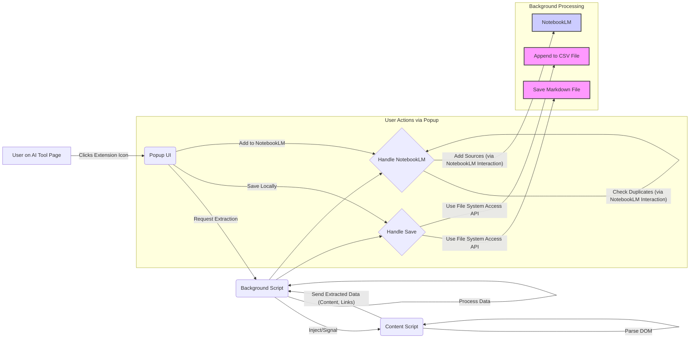

# Design Document: AI Research Extractor Chrome Extension

## 1. Introduction

This document outlines the technical design for the AI Research Extractor Chrome Extension, based on the specifications in `docs/requirements.md`. It details the architecture, components, data structures, and interaction patterns necessary to fulfill the functional and non-functional requirements.

## 2. Architecture Overview

The extension will follow a standard Chrome Extension architecture utilizing:

*   **Content Scripts:** Injected into the pages of the target AI research tools (OpenAI Deep Research, Google Gemini Deep Research, Grok Deep Research). Responsible for DOM parsing to extract content and links.
*   **Background Script (Service Worker):** Acts as the central coordinator. Receives data from content scripts, manages storage operations (CSV, Markdown), handles communication with the popup, and orchestrates NotebookLM integration logic.
*   **Popup UI:** A simple browser action popup allowing the user to trigger extraction and select options (Save Locally, Add to NotebookLM).
*   **Storage:** Utilizes `chrome.storage.local` for storing the path/handle to the CSV file and potentially user preferences. Actual Markdown files and the CSV will be saved to the user's local filesystem using the File System Access API (requiring user permission).

### 2.1 Data Flow Diagram (Mermaid)



## 3. Component Design

### 3.1 Content Scripts (`content_script.js`)

*   **Responsibility:** Identify the AI tool, locate and extract research content and source links from the page's DOM.
*   **Logic:**
    *   On load or signal from background script, check `window.location.href` to determine the AI tool (OpenAI, Gemini, Grok).
    *   Use specific, robust DOM selectors (potentially based on IDs, classes, ARIA attributes) tailored for each AI tool's results page structure. These selectors will need careful identification and may require updates if the sites change.
    *   Extract the main content block, attempting to preserve basic HTML structure (which will be converted to Markdown later).
    *   Extract source links (typically `<a>` tags within a specific section).
    *   Extract page title or research query for context.
    *   Send extracted data (HTML content string, array of link objects `{url: '', title: ''}`, page title, identified AI tool) to the background script via `chrome.runtime.sendMessage`.
*   **Error Handling:** Handle cases where DOM elements are not found; send an appropriate error message back to the background script.

### 3.2 Background Script (`background.js` - Service Worker)

*   **Responsibility:** Orchestrate extraction, manage storage, handle NotebookLM logic, respond to popup requests.
*   **Logic:**
    *   Listens for messages from the popup (`chrome.runtime.onMessage`) to initiate extraction.
    *   Listens for messages from content scripts containing extracted data.
    *   **Extraction Trigger:** Sends a message to the active tab's content script (`chrome.tabs.sendMessage`) to start the process.
    *   **Data Processing:** Receives raw HTML content and links. Uses a library (e.g., `turndown`) to convert HTML to Markdown.
    *   **Local Storage (`chrome.storage.local`):** Store configuration like the file handle for the CSV file (obtained via File System Access API) for persistent access.
    *   **File System Access API:**
        *   **Markdown:** On "Save Locally", prompt the user (using `window.showSaveFilePicker`) to choose a save location for the *first* Markdown file. Generate filename (e.g., `YYYY-MM-DD-research-title.md`). Construct the full Markdown content including Jekyll front matter (`title`, `date`, `ai_tool`, `source_url`). Write the file. For subsequent saves, potentially reuse the last directory.
        *   **CSV:** On the *first* "Save Locally" or link export, prompt the user to save a `research_links.csv` file. Store the obtained file handle in `chrome.storage.local`. For subsequent saves, retrieve the handle, get a writable stream (`createWritable({ keepExistingData: true })`), seek to the end, and append the new link data (Timestamp, AI_Tool, Research_Query_or_Title, Source_URL, Source_Title). Include CSV header if creating the file.
    *   **NotebookLM Integration:**
        *   Requires interaction with the NotebookLM web interface, as no public API exists.
        *   **Source Addition:** The most feasible approach is likely to:
            1.  Prepare the list of source URLs (including the original article URL and selected/all extracted links, after deduplication).
            2.  Instruct the user (via popup UI/new tab message) to navigate to their target NotebookLM notebook.
            3.  Provide the user with the formatted list of links to manually paste into the "Add Sources" -> "Websites" section in NotebookLM. (Alternatively, explore if programmatic interaction via content scripts injected into NotebookLM is possible, though likely complex and fragile).
        *   **Deduplication:** Before preparing the list for the user, the extension would need to *read* existing sources from the target NotebookLM notebook. This likely also requires a content script injected into NotebookLM to parse the sources list from the DOM, which is complex and depends heavily on NotebookLM's structure. A simpler approach might be to just add all selected links and let the user manage duplicates manually within NotebookLM, acknowledging the 100 limit constraint. *Decision: Opt for the simpler approach initially - provide the list for manual addition, skipping programmatic deduplication due to complexity/fragility.*
*   **State Management:** Manage the state of ongoing extractions or operations.

### 3.3 Popup UI (`popup.html`, `popup.js`)

*   **Responsibility:** Provide user interface to trigger actions.
*   **Components:**
    *   Button: "Extract Research & Links"
    *   Status Area: Display messages (e.g., "Extracting...", "Saved!", "Error: Could not parse.", "Provide links for NotebookLM below:").
    *   Options (appear after successful extraction):
        *   Button: "Save Locally (MD & CSV)"
        *   Button: "Prepare Links for NotebookLM"
        *   Checkbox/List (Optional for NotebookLM): Allow selecting specific links (if implementing selection).
    *   Display Area (for NotebookLM): Text area to show the prepared list of links for manual copy-pasting.
*   **Logic (`popup.js`):**
    *   Add event listeners to buttons.
    *   On "Extract", send a message to the background script to start the process.
    *   Receive status updates/results from the background script and update the UI accordingly.
    *   On "Save Locally", send a message to the background script.
    *   On "Prepare Links for NotebookLM", send a message to the background script; display the returned link list.

## 4. Data Structures

*   **Extracted Link Object:** `{ url: string, title: string | null }`
*   **Extracted Data Message (Content Script -> Background):**
    ```json
    {
      "type": "extractionResult",
      "success": boolean,
      "data": {
        "aiTool": "OpenAI" | "Gemini" | "Grok",
        "pageTitle": string,
        "sourceUrl": string, // URL of the AI research page itself
        "htmlContent": string, // Raw HTML of the main research content
        "links": [ { "url": string, "title": string | null } ]
      } | null,
      "error": string | null
    }
    ```
*   **Markdown Front Matter:**
    ```yaml
    ---
    title: "Research Query or Page Title"
    date: "YYYY-MM-DD HH:MM:SS"
    ai_tool: "OpenAI" | "Gemini" | "Grok"
    source_url: "URL of the original AI research page"
    tags: [research, ai, extracted] # Optional
    ---
    ```
*   **CSV Row:** `Timestamp (ISO 8601), AI_Tool, Research_Query_or_Title, Source_URL, Source_Title`

## 5. API and Integration Points

*   **Chrome APIs:**
    *   `chrome.runtime`: Messaging between components.
    *   `chrome.tabs`: Querying active tab, sending messages to content scripts.
    *   `chrome.storage.local`: Storing configuration (CSV file handle).
    *   `chrome.action`: Managing the popup.
    *   `chrome.scripting`: Programmatically injecting content scripts if needed.
*   **Web APIs:**
    *   `DOM Parsing`: `document.querySelector`, `document.querySelectorAll`, element properties.
    *   `File System Access API`: `window.showSaveFilePicker`, `FileSystemFileHandle.createWritable`.
*   **External Libraries:**
    *   `turndown` (or similar): For HTML-to-Markdown conversion.
*   **NotebookLM:** Manual user interaction required for adding sources. No direct API integration planned due to lack of public API and fragility of DOM scraping NotebookLM itself.

## 6. Security Considerations

*   **Permissions:** Request minimal permissions in `manifest.json`:
    *   `activeTab`: To interact with the current page when the user invokes the extension.
    *   `scripting`: To inject content scripts into the target AI tool pages.
    *   `storage`: To save configuration (CSV file handle).
    *   *Note:* File System Access API permissions are granted by the user per-file/directory via prompts, not in the manifest.
*   **Content Script Isolation:** Content scripts run in isolated worlds but have access to the page's DOM. Ensure parsing logic doesn't inadvertently execute scripts from the page. Sanitize data where necessary, although primarily passing structured data, not executing fetched content.
*   **Data Handling:** All user data (extracted content, links) is stored locally on the user's machine via the File System Access API or within `chrome.storage.local`. No data is transmitted externally by the extension itself.

## 7. UI/UX Mockup (Conceptual)

*   **Initial State:** Simple popup with a single "Extract Research & Links" button.
*   **Extraction in Progress:** Button disabled, status message "Extracting...".
*   **Extraction Complete:** Status message "Extraction successful!". Buttons "Save Locally (MD & CSV)" and "Prepare Links for NotebookLM" appear. Maybe a count of links found.
*   **Save Complete:** Status message "Content saved to [filename].md. Links appended to [filename].csv".
*   **Prepare for NotebookLM:** Status message "Copy the links below and paste into NotebookLM:". A text area displays the list of URLs.
*   **Error State:** Status message detailing the error (e.g., "Error: Could not identify AI tool.", "Error: Failed to parse content.").
